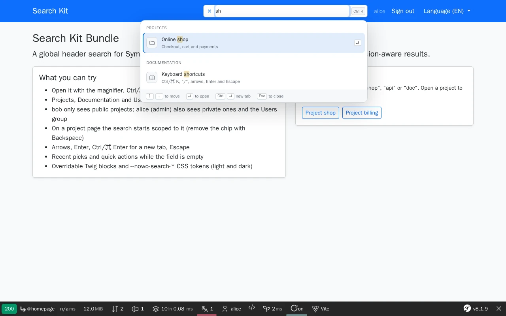

# Search Kit Bundle

[](https://github.com/nowo-tech/SearchKitBundle/actions/workflows/ci.yml) [](https://packagist.org/packages/nowo-tech/search-kit-bundle) [](https://packagist.org/packages/nowo-tech/search-kit-bundle) [](LICENSE) [](https://php.net) [](https://symfony.com) [](https://github.com/nowo-tech/SearchKitBundle) [](#tests-and-coverage)

> ⭐ **Found this useful?** [Install from Packagist](https://packagist.org/packages/nowo-tech/search-kit-bundle) · Give it a **star** on [GitHub](https://github.com/nowo-tech/SearchKitBundle) so more developers can find it.

**Search Kit Bundle** — a global header search (command palette) for Symfony: a magnifier that stretches into a field, grouped permission-aware results from your own providers, Ctrl/⌘ K, keyboard navigation, recents, UX Icons and theme tokens.

> 📋 **Compatible with Symfony 7.4+ and 8.0–8.1+** — PHP 8.3+ (Symfony 8.x requires PHP 8.4+).


This bundle is **FrankenPHP worker mode friendly**. See [docs/FRANKENPHP-WORKER-AUDIT.md](docs/FRANKENPHP-WORKER-AUDIT.md).

## Features



- **Header magnifier that stretches into a field** in place (no modal), results in a dropdown under it; full-width field and dropdown on phones
- **Your groups, your rules**: implement `SearchProviderInterface` once per group (Projects, Issues, Users, …) — autoconfigured, ordered by priority; the kit never decides what a user may see
- **Pages group out of the box** from [DashboardMenuBundle](https://github.com/nowo-tech/DashboardMenuBundle) menus (permission-filtered tree, breadcrumbs, deduplicated by URL)
- **Scope chip**: `SearchScopeResolverInterface` starts the search inside the current project / team / space; Backspace removes it
- **Keyboard first**: Ctrl/⌘ K anywhere, `/` outside fields, ↑ ↓ across groups, Enter, Ctrl/⌘ Enter for a new tab, Esc or a click outside to fold
- **Accessible**: ARIA combobox + listbox, `aria-activedescendant`, live result count, `prefers-reduced-motion`
- **Recents** (per browser, `localStorage`, text only — never HTML) and configurable **quick actions** while the query is empty
- **Safe rendering**: user text is escaped and highlighted with `<mark>` through DOM nodes; only same-site paths or http(s) URLs are ever navigated
- **Debounced, aborted requests**; JSON endpoint rate limited per user, `Cache-Control: no-store, private`, 429 `{"error": "rate_limited"}`
- **Overridable Twig blocks**, **theme tokens** (`--nowo-search-*`, light / dark), **Symfony UX Icons** with a built-in SVG fallback
- Framework-agnostic browser module (auto-mounted IIFE), an optional **Stimulus** wrapper and `nowo-search:state` / `nowo-search:navigate` events (morphing icons, Turbo)
- **FrankenPHP worker mode** friendly; 7 locales (en, es, fr, de, it, pt, nl)

## Installation

```bash
composer require nowo-tech/search-kit-bundle
```

With **Symfony Flex**, the recipe registers the bundle and creates `config/packages/nowo_search_kit.yaml` and `config/routes/nowo_search_kit.yaml` (prefix `/search`). Without Flex, see [docs/INSTALLATION.md](docs/INSTALLATION.md).

```php
// config/bundles.php
return [
    Nowo\SearchKitBundle\NowoSearchKitBundle::class => ['all' => true],
];
```

## Quick start

1. Import the routes and publish the assets (`bin/console assets:install`):

```yaml
# config/routes/nowo_search_kit.yaml
nowo_search_kit:
    resource: '@NowoSearchKitBundle/Resources/config/routes.php'
    prefix: /search
    trailing_slash_on_root: false
```

2. Add one provider per group — it returns **only what the user may open**:

```php
use Nowo\SearchKitBundle\Contract\SearchProviderInterface;
use Nowo\SearchKitBundle\Model\SearchGroup;
use Nowo\SearchKitBundle\Model\SearchItem;
use Nowo\SearchKitBundle\Model\SearchQuery;
use Symfony\Component\DependencyInjection\Attribute\AsTaggedItem;

#[AsTaggedItem(priority: 50)]
final readonly class ProjectSearchProvider implements SearchProviderInterface
{
    public function __construct(private ProjectRepository $projects)
    {
    }

    public function search(SearchQuery $query): ?SearchGroup
    {
        $rows = $this->projects->searchVisibleTo($query->user, $query->text, $query->limit);

        return new SearchGroup('projects', 'Projects', array_map(
            static fn (Project $p): SearchItem => new SearchItem($p->getName(), '/projects/' . $p->getId(), $p->getSlug(), 'tabler:folder'),
            $rows,
        ));
    }
}
```

3. Render the search in your signed-in header:

```twig
{{ include('@NowoSearchKitBundle/search.html.twig') }}
```

Full guide: [docs/INSTALLATION.md](docs/INSTALLATION.md) · options: [docs/CONFIGURATION.md](docs/CONFIGURATION.md) · providers, scope, templates, theme, JS: [docs/USAGE.md](docs/USAGE.md).

## Requirements

- PHP `>=8.3 <8.6` (8.3 floor: typed class constants)
- Symfony 7.4, 8.0, and 8.1+
- SecurityBundle, TwigBundle, Form, Asset, RateLimiter (installed with the bundle)
- Optional: `symfony/ux-icons` (icons from your set; built-in SVG otherwise), `nowo-tech/dashboard-menu-bundle` (Pages group)

### Version information

| Version | PHP | Symfony | Status |
| --- | --- | --- | --- |
| 1.x | 8.3 – 8.5 | 7.4, 8.0, 8.1+ | Supported (bug and security fixes) |

## Demo

A Symfony 8.1 demo runs on FrankenPHP (worker mode by default); it needs no database:

```bash
make -C demo up
# Demo started at: http://localhost:8157
```

Sign in as **alice** (admin) or **bob** (password `password`), press Ctrl/⌘ K and type `shop`, `api` or `doc`. See [docs/DEMO-FRANKENPHP.md](docs/DEMO-FRANKENPHP.md).

Playwright end-to-end tests and the README screenshots (WebP under `docs/images/demo/`): `make -C demo/symfony8 test-e2e`
and `make -C demo/symfony8 demo-screenshots` (see [docs/CONTRIBUTING.md](docs/CONTRIBUTING.md)).

## Documentation

- [Installation](docs/INSTALLATION.md)
- [Configuration](docs/CONFIGURATION.md)
- [Usage](docs/USAGE.md)
- [Contributing](docs/CONTRIBUTING.md)
- [Code of Conduct](CODE_OF_CONDUCT.md)
- [Changelog](docs/CHANGELOG.md)
- [Upgrading](docs/UPGRADING.md)
- [Release](docs/RELEASE.md)
- [Security](docs/SECURITY.md)
- [Engram](docs/ENGRAM.md)
- [Spec-driven development](docs/SPEC-DRIVEN-DEVELOPMENT.md)
- [GitHub Spec Kit](docs/SPEC-KIT.md)

### Additional documentation

- [Architecture](docs/ARCHITECTURE.md)
- [PSR evaluation](docs/PSR.md)
- [Coverage policy](docs/COVERAGE.md)
- [Demo FrankenPHP](docs/DEMO-FRANKENPHP.md)
- [FrankenPHP worker audit](docs/FRANKENPHP-WORKER-AUDIT.md)
- [GitHub CI](docs/GITHUB_CI.md)
- [GitHub About](docs/GITHUB.md)

## Tests and coverage

- Tests: PHPUnit (unit, integration, functional), Vitest (TypeScript), Playwright (demo e2e)
- PHP: 100%
- TS/JS: 97.26%
- Python: N/A

PHP line coverage: **100%** of includable `src/` (gate **≥ 99%**; strict gate `make test-coverage-100`). TypeScript coverage is the minimum of statements / branches / functions / lines (REQ-TEST-009): statements, functions and lines 100%, branches 97.26% (defensive fallbacks); Vitest thresholds 100 / 95 (branches), make gate **≥ 90%**.

```bash
make test
make test-coverage
make test-ts
make qa
```

## License

MIT © 2026 Héctor Franco Aceituno / Nowo.tech
